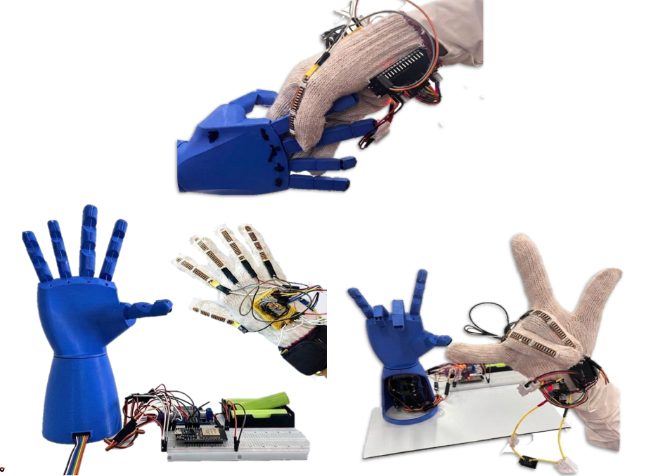

# 🦾 Wireless ESP-NOW Bionic Hand & Smart Gesture Control Glove

A wireless, real-time bionic hand system powered by **ESP32** microcontrollers and **ESP-NOW** communication protocol. The system consists of a **Glove Controller** equipped with flex sensors that wirelessly maps human hand movements to a **16-DOF/5-Servo Robotic Hand** with automated calibration and safety angle constraints.

---

## 📷 System Overview / Preview
> 

  

---

## 🚀 Key Features

- **Wireless Low-Latency Communication:** Utilizes **ESP-NOW** for peer-to-peer fast wireless data transmission without requiring a traditional Wi-Fi router.
- **5-Finger Independent Articulation:** Real-time individual control for the Thumb, Index, Middle, Ring, and Little fingers.
- **Automatic Sensor Calibration:** The glove side features dynamic auto-calibration (`minVal` / `maxVal` tracking) to adapt to different hand flex ranges seamlessly.
- **Safety Constraints & Mapping:** Maps analog flex sensor readings to precise servo angles ($0^\circ$ to $180^\circ$) with built-in software safety bounds.
- **Modular Architecture:** Clean separation into **Transmitter (Glove)** and **Receiver (Robot Hand)** firmware modules.

---

## 🛠️ System Architecture & Hardware Stack

| Component | Target Side | Details / Pins |
| :--- | :--- | :--- |
| **ESP32 Dev Board** | Both Sides | Core Microcontroller (Wi-Fi Stack Enabled) |
| **Flex Sensors (x5)** | Glove Side | Connected to Analog Pins: `32`, `33`, `34`, `35`, `36` |
| **Servo Motors (x5)** | Robot Side | Controlled via Pins: `13` (Thumb), `14` (Index), `25` (Middle), `26` (Ring), `27` (Little) |
| **Communication** | Wireless | ESP-NOW Protocol (Peer-to-Peer MAC targeting) |

